# 溯时流源 → YOSAKI Memory V2 功能完整性审计

> 2026-10-31，只读源码审计；**不是**真机、正式数据库、真实模型或上下文注入验收。本轮未运行插件、YOSAKI 服务、模型或迁移。原插件基线 `D:/AI xiangmu/插件/溯时流源` HEAD `ad579fe7691eb4e0b32d2a2c08131dd49eae6234`，版本 `0.1.8`；YOSAKI 当前未提交工作区，HEAD `1e096aeecddda8c5e8989fda33026e4fb658353f`。以下源码位置以两仓库根目录为基准，`P:` 指原插件，`Y:` 指 YOSAKI。`reference.ts` 含私人示例，仅核对常量如何被提示词使用，不在此文复制示例正文。

## 判定规则与总览

- **插件状态**：“已接线”指从宿主入口或 UI 可到达；“条件式”表示还需配置、调用 `tick`、人工确认或第三方工具；“原型／未验证”指有代码但没有该效果的运行证据；“未实现”指源码没有相应机制。已有测试文件只证明项目曾写测试，不当作本次运行结果。
- **迁移状态**：“完整保留”须有等价的用户行为、权限及失效验收；“部分实现”只承认明确的子能力；“尚未迁移”指缺少对应入口；“需重设计”指原行为触及新的权威或安全边界；“有意替代”须说明原行为和等价保障。M1～M3.6、P1-A、P2 与 M5-A1 均为当前**隔离代码**状态，其中 M3／P2／M5-A 安装式 API 未在 `main.py` 注册，M2 仅未注册的只读影子模块；正式数据库迁移、上下文切换和真实模型质量仍待独立验收。`Y:backend/app/main.py`、`Y:backend/app/memory_v2_derivation_api.py:1,50`、`Y:backend/app/memory_v2_shadow.py:1`。
- **证据性质**：原插件的模型改写、摘要、向量与世界书操作均依赖外部模型或宿主。源码可证明调用路径和默认值，不能证明持续自动运行、真实模型质量、实际注入或费用。特别是 `autoCapture=false`、`linkAutoEnabled=false`，`tick` 没有无人值守定时注册。`P:src/core/config.ts:4-9`、`P:src/main.ts:99-105`、`P:src/packages/sushiliuyuan.ts:63-69`。

### 原架构与当前对应关系

```mermaid
flowchart LR
  P0[Operit 聊天 Hook／历史与文件导入] --> P1[原文与导入批次]
  P1 --> P2[话题预览／去重]
  P2 --> P3[条目：标题、梗概、关键词、对话纪事]
  P3 --> P4[L0～L5 时间投影／L1～L4 摘要]
  P3 --> P5[向量／关键词／关联]
  P4 --> P6[时间轴、展开、世界书投影]
  P5 --> P6
  Y0[YOSAKI messages／activity_operations] --> Y1[M1 来源索引、时间片段、词项]
  Y1 --> Y2[M2 未注册的 RAW 召回协调层]
  Y1 --> Y3[M3 未注册的 CLEANED／NARRATIVE／DIGEST 派生版本]
  Y3 --> YP[P2 L0～L5 只读投影]
  YP --> Y4[M5-A1 隔离只读年历与诊断预览]
  Y2 -.未来显式选定候选.-> YP
  Y2 --> Y5[未来 P3/P4 混合检索与受控浮现]
  Y0 -.原始权威与读时校验.-> Y3
```

原插件以一条 `Memory` 同时承载 RAW、派生正文、标题、梗概、关键词、权重及注入参数；YOSAKI 以现有消息和活动为原始权威、M1 索引可重建、M3 派生版本独立审核。**保留能力，不复制原插件的一体化权威模型。** `P:src/core/types.ts:59-92`；`Y:backend/app/memory_v2_sources.py:81`、`Y:backend/app/memory_v2_derivation_schema.py:8-52`。

## 逐功能迁移矩阵

表中“依赖／边界”的“模型”指需要模型生成或向量服务；“上下文”指正式注入。所有未来档案写入、派生读取、索引词项和日志均继承 YOSAKI 当前角色与 owner 权限，不把聊天模型自述提升为已验证事实。

### A. 来源、导入、话题和条目

| 功能、插件源码与实际条件 | 用户可见行为 | YOSAKI 对应源码 | 判定、缺口与迁移方式 | 行为验收；依赖／权限 |
| --- | --- | --- | --- | --- |
| **A1 绑定窗口并自动收 RAW**。`P:src/main.ts:81-105` 注册 Hook；`P:src/core/archive.ts:825-839` 按 owner 角色和窗口去重存 inbox；默认 `autoCapture=false`。**条件式已接线**。 | 开启后匹配窗口的新 user/assistant 正文进入收件箱；不立即生成条目。 | `Y:backend/app/memory_v2_sources.py:81-106` 读取现有 `messages`；M1 无另一个 Hook。 | **有意替代**：YOSAKI 原生消息即事实源，无需再复制到 inbox；原插件跨应用抓取能力未迁。 | 原生聊天写入后显式索引可见，跨角色／工具消息不可入；不新增抓取权限。无需模型／上下文。 |
| **A2 文本／JSON／宿主历史导入**。`P:src/core/imports.ts:4-53`；`P:src/main.ts:41-55` 校验角色卡与普通窗口、单批 ≤2000；文件由用户 UI 选择。**已接线，来源依赖宿主**。 | 粘贴、文件选取或按历史消息序号预览。无日期的文本要求明确日期。 | `Y:backend/app/memory_v2_import_preview.py`、`memory_v2_import.py`、`memory_v2_import_api.py`、`Y:frontend/src/ChronicleImportWizard.vue` 在隔离应用中提供文件预览、确认、RAW 导入及查看。 | **部分实现**：JSON／MD／TXT 与受限 ZIP 的合成文件导入已接线；宿主直接历史抓取、真实小样本与正式部署未验收。MD／TXT 明示有损，缺少时刻不伪造。 | 合成文件预览、确认、按来源 RAW 查看已测；真实私人历史仍需授权。无模型／正式上下文。 |
| **A3 来源优先与同源去重**。`P:src/core/archive.ts:408-459` 先存批次再确认；`P:src/core/imports.ts:54-56` 用 chatId+消息 ID，否则时间／角色／内容；确认可续跑。**已接线**。 | 重复确认或重叠导入不重复建条目；原文仍可查看。 | `Y:backend/app/memory_v2_import_schema.py` 的文件 SHA、外部身份声明与逐消息收据；`memory_v2_import.py` 原子游标、重复拒绝；M1 索引仍独立。 | **部分实现**：可证实的同源重复被拒绝，跨文件无外部 ID 的相同内容不合并；仍需人工查看可能重复。导入片段重试复用条目 UUID。 | 合成重复文件、外部 ID 重叠、事务恢复已测；真实格式适配仍待扩展。无需模型／上下文。 |
| **A4 时间分段与话题人工调整**。`P:src/core/imports.ts:57-76` 30 分钟仅建议；`P:src/ui/archive.ui.ts:171-191` 可改标题／日期、拆分／合并；`P:src/core/archive.ts:235-245` 覆盖验证。**已接线**。 | 导入前调整话题边界，不能遗漏或重叠。 | `Y:backend/app/memory_v2_import.py` 提供时间建议、完整覆盖校验和边界版本；`Y:frontend/src/ChronicleImportWizard.vue` 可手动调整并确认。M1 时间片段仍独立。 | **部分实现**：人工整理边界可变成 P1-A 草稿条目；不把时间建议称作语义话题。正式话题关系、日期编辑审计仍待 P1-B。 | 30 分钟边界、未知／日期精度、拆并与幂等草稿已测；人工编辑需授权。无模型。 |
| **A5 模型话题建议**。`P:src/platform/models.ts:82-119` 每批 60 条建议，失败时合并并标警告；`P:src/ui/archive.ui.ts:174` 显式按钮，仍须预览确认。**条件式已接线**。 | 为导入批次建议话题和标签，不自动确认。 | `Y:backend/app/memory_v2_contract.py:18-28` 只预留来源集合；无建议任务。 | **尚未迁移**，不应把 M1 时间片段称为语义话题。后续作为可选派生建议，来源和审核绑定。 | 模型建议不可直接变正式主题；边界覆盖完整、错归属可拒绝。依赖模型、费用许可与编辑权限；不接上下文。 |
| **A6 单条经历完整条目**。`P:src/platform/models.ts:32-80` 保序分批改写后另生成 title/summary/keywords/tags，组装标题日期、梗概、对话记录；`P:src/core/archive.ts:737-754` 格式门槛。需任务模型与 `tick`。**条件式已接线**。 | 一条经历拥有完整标题、日期、关键词、梗概及详细纪事。 | `Y:backend/app/memory_v2_entries.py` P1-A 元数据与有序来源；`Y:backend/app/memory_v2_derivation.py` 纪事版本；`Y:frontend/src/ChronicleApp.vue` 隔离组合展示。 | **部分实现**：人工标题／关键词／标签／单经历梗概有版本、审核与精确失效；合成页面可读。原插件的自动模型标题／梗概生成和正式用户接入仍未迁移。时间 DIGEST 不冒充单经历梗概。 | 四层分别查源、版本、权限；梗概不冒充原话；修改来源或依赖正文使旧元数据失效。模型生成另需费用及人审。 |
| **A7 第一人称精修与范文**。`P:src/platform/models.ts:47-80` 单条 ≤12000 字、常规 6000 字分批，`reference.ts:2-3` 两个实际示例被嵌入提示词；保留双方 speaker，模型另生成元数据。**条件式已接线，真实忠实性未由本次验证**。 | 日中混合对话整理为阿夜第一人称详细记事。 | `Y:backend/app/memory_v2_model_adapter.py:4-16,23-54` 保序结构化分批；`Y:backend/app/memory_v2_fidelity.py:11-73` 部分规则；`Y:backend/app/memory_v2_derivation.py:225-254` 人审后激活。 | **部分实现且有意修正**：M3.5 v3 只允许派生发言归属“我说／她说”；范文的自然用户叙述与当前强制前缀仍有差距。旧插件可自动将模型结果置 ready，YOSAKI 必须保留人工忠实性审核。 | 固定合成样本逐轮核发言人、否定、条件、更正、日语、括号新事实、无来源内省；真实模型质量另验。依赖可选模型，不得自动发布或冒充心潮念。 |
| **A8 编辑、元数据与权重**。`P:src/core/archive.ts:309-374` 可改标题、正文、梗概、关键词、标签、日期、权重、启用及注入参数，旧版入 `revisions`；`P:src/ui/archive.ui.ts:134-153` UI 当前只直接编辑标题、正文、权重，其他字段可走工具。**已接线**。 | 用户／获授权角色维护档案和关联，查看历史；RAW 字段不可编辑。 | `Y:backend/app/memory_v2_entries.py` P1-A 元数据修订／审核；`Y:backend/app/memory_v2_derivation_api.py` M3 正文版本；`Y:frontend/src/ChronicleApp.vue` 只读展示。 | **部分实现**：人工元数据已有可追溯修订，M5-A0 只读；权重、人工主题／关联和编辑 UI 仍待 P1-B／M5-A 管理阶段。 | 每次人工改动产生新版本、旧审核失效、相关派生依赖失效；不覆盖消息或活动。编辑权限独立于只读与召回。 |
| **A9 仅有人工派生正文的旧条目**。`P:src/core/archive.ts:291-307` 的 `add_memory` 可只提交 `content_full`，此时 `rawMessages=[]`、`rawText=''`、`sourceKeys=[]`。**已接线，但无原始聊天证据**。 | 手工添加的历史条目能显示和编辑，却不能声称可逐句回到 RAW。 | `Y:backend/app/memory_v2_derivation.py:72-84,133-191` 当前 M3 派生需要有序来源；旧人工记忆继续留在原 `memories` 权威。 | **需重设计**：迁移此类条目时保留“来源未知／人工陈述”性质，不伪造消息 ID 或把正文升级为已验证事件；可作为受控人工参考单列。 | 无来源条目不能通过 RAW 溯源验收，也不能被自动合并进 Chronicle 的“已证实聊天”集；显示明确来源状态。无需模型，需编辑权限。 |

### B. 时间树、检索、关联与浮现

| 功能、插件源码与实际条件 | 用户可见行为 | YOSAKI 对应源码 | 判定、缺口与迁移方式 | 行为验收；依赖／权限 |
| --- | --- | --- | --- | --- |
| **B1 L0～L5 随时间换档**。`P:src/core/time.ts:24-42` 默认 7／30／90／180／365 天；`P:src/core/archive.ts:128-139,376-385` 每次读取按当前时间计算。**已接线**。 | 近 7 天全文；其后周、月、季、半年；一年以上标题索引，RAW 不删除。 | `Y:backend/app/memory_v2_time_projection.py` P2 隔离动态树；`Y:frontend/src/ChronicleApp.vue` M5-A0 隔离浏览页面。 | **部分实现**：六档浏览、逐层展开和 RAW 回查已在合成数据页面联动；正式接入与自动任务维护未完成。时间档位只改变展示粒度，不是检索屏障。 | 冻结时钟、边界、跨时区及旧 RAW 回查经隔离测试；M5-A0 浏览器交互已测，正式用户行为未验收。 |
| **B2 L1～L4 分级摘要依赖**。`P:src/core/digests.ts:12-48` 分层成员／指纹／下级依赖；`P:src/core/archive.ts:642-650,669-685,791-799` 先下级再上级、旧指纹拒绝。**条件式已接线，需 `tick`**。 | 周、月、季度、半年摘要随来源变化失效重建；L0/L5 不生成摘要。 | `Y:backend/app/memory_v2_time_projection.py` P2 范围及审核检查；`Y:frontend/src/ChronicleApp.vue` 显示有效、缺失、未审核与任务异常状态。 | **部分实现**：隔离页面可查看合成的已审周期 DIGEST 并安全降级；按日龄自动维护、真实模型质量及正式接入仍缺。 | 来源或成员变化拒绝旧摘要；标题等未被 `raw_sources_v1` 使用的字段不无端失效。未来新依赖须另设 profile。 |
| **B3 时间轴过滤与分段展开**。`P:src/core/archive.ts:376-406` 分页、日期／档位／标签、投影内容；`unfold` 每页 100～16000 字且第 1 页计访问次数。`P:src/ui/archive.ui.ts:104-153`。**已接线**。 | 搜索／浏览／逐页翻开完整正文或 RAW，查看关联。 | `Y:backend/app/memory_v2_time_api.py` P2 安装式树和 RAW 分页；`Y:backend/app/memory_v2_calendar_api.py` 条目日期／关键词查询；`Y:frontend/src/ChronicleApp.vue` 逐层浏览和并排对照。 | **部分实现**：隔离前后端已联动树、日期筛选及长 RAW 分页；标签筛选、关联浏览、正式接入未做。GET 不写访问统计。 | 浏览器已验 L1→L5 和旧 RAW 页；游标视角变化返回 409，来源失效拒绝正文。 |
| **B4 关键词与 hot/all**。`P:src/core/archive.ts:387-395` 标题、关键词、标签和梗概评分；默认 `hot` 只查近 90 天，`scope=all` 才查旧档。**已接线**。 | 主动搜索，可按标签／时间筛选；旧档需选择全范围。 | `Y:backend/app/memory_v2_sources.py:41-78` 中日文二字词；`Y:backend/app/memory_v2_api.py:204-252` 词项分页与权限复核。 | **部分实现／有意替代**：M1 默认可检索全历史，不让时间变永久屏障；尚无条目标题、关键词、标签参与排序及同等搜索筛选。 | 双字人名、短词、全历史与状态变更测试；每次读时复核角色和来源。无需模型；索引词项属私人数据。 |
| **B5 向量索引与语义查找**。`P:src/platform/models.ts:10-31` 外部 embeddings；`P:src/core/archive.ts:140-167,769-774,872-880` 标题＋梗概＋关键词嵌入、模型／维度／输入指纹、余弦与阈值 0.35；`P:src/packages/sushiliuyuan.ts:41-60` 查询向量。**条件式已接线，需独立 Key／执行任务**。 | 语义近邻搜索；修改模型或维度须显式重嵌入。 | `Y:backend/app/memory_v2_contract.py:11-14,44-66` 预留生成器；`Y:backend/app/memory_v2_recall.py:73-105` 目前仅词项。 | **尚未迁移**：M1 词项、M2 规则召回绝非向量等价。将向量作为 M2 的独立候选生成器，复用同一权限／来源过滤器，不建立第二套召回权威。 | 指纹变化、删源、换模型／维度和跨角色均不能返回旧向量；语义金标准报告召回与误报、成本和降级。依赖向量服务与另行费用／隐私授权；不自动注入。 |
| **B6 hybrid 降级**。`P:src/packages/sushiliuyuan.ts:41-60` 先向量、合并关键词去重；向量失败退关键词；`P:src/core/archive.ts:387-395` 退化标记。**已接线但向量条件式**。 | 向量不可用仍可检索，不丢主动查阅。 | `Y:backend/app/memory_v2_recall.py:107-204` 多生成器接口及统一筛选，但没有向量和 hybrid API。 | **部分实现**：保留候选生成器编排；后续将向量、词项、主题关联候选归并，按体验 key 去重，返回降级原因。 | 同一经历多视图只占一名额；向量故障返回安全词项结果并标记。依赖向量但降级不依赖。 |
| **B7 人工／可选自动关联**。`P:src/core/archive.ts:516-533,692-715,775-788` 手动无向边，自动模式默认关闭；嵌入相似度 ≥0.78 且模型判断 related 才写入，显示阈值 0.75。**人工已接线；自动条件式**。 | 查看相关记忆、手动增删；自动发现须配置。 | `Y:backend/app/memory_v2_contract.py:11-14` 预留跨时主题；M1 时间片段不是关系；无关系维护。 | **尚未迁移／需重设计**：按稳定来源集合建有向或明示对称关系，区分人工确认、模型建议、时间邻近；不把模型解释或时间近邻升为确定因果。M4 经验因果边界另行管理。 | 关系含类型、证据、审核、版本和失效；撤销后不可再显示。自动建议依赖模型／向量授权；人工关联不依赖。 |
| **B8 世界书浮现投影**。`P:src/core/archive.ts:883-899` L0 正文、旧档摘要／标题，`weightFloor=0.3`；`P:src/platform/worldbook.ts:8-66` 显式 dry-run 后同步，按映射、名称和列表校验。**接线但依赖 `worldbook_tools_plus`，本次未验真机注入**。 | 开启宿主世界书后，按关键词、alwaysActive、priority、scanDepth、injectTarget 等宿主参数可能浮现；可预览增改停用。 | `Y:backend/app/memory_v2_recall.py:107-204` 未注册候选选择；`Y:backend/app/memory_v2_context.py:65-103` RAW 预算编译；旧聊天注入链独立。 | **需重设计**：不复制 worldbook 为第二权威，也不默认推送。由 M2 统筹候选、信任、冷却和 Token，保留可见的浮现候选／解释／关闭能力；旧正式参考继续保留。 | 主动查阅与被动候选分别验收；未批准派生、失败操作和跨角色均零注入。正式上下文切换须单独批准。 |
| **B9 触发、排序、冷却、频率**。插件没有独立逐回合召回调度／冷却状态；世界书参数由宿主决定，搜索按词项／权重，向量按余弦；`P:src/core/archive.ts:387-395,872-899`。**逐回合动态浮现未实现／宿主效果未验**。 | 插件能准备投影与手动搜索，不能据源码声称有自己的 30 分钟浮现冷却。 | `Y:backend/app/memory_v2_recall.py:10-18,174-204` 保守触发、外部传入冷却；`Y:backend/app/memory_v2_shadow.py:1-27` 只读影子。 | **部分实现、无正式入口**：未来 M2 统一控制触发、候选、预算、已实际浮现才入冷却；主动追问绕过被动冷却。不得把宿主未知策略写成原插件已实现功能。 | 连续多轮、换角色／会话、源修订、主动追问与无关问题；冷却仅正式成功浮现后写。当前不依赖模型，正式上下文另批。 |

### C. 任务、维护、UI、备份和权限

| 功能、插件源码与实际条件 | 用户可见行为 | YOSAKI 对应源码 | 判定、缺口与迁移方式 | 行为验收；依赖／权限 |
| --- | --- | --- | --- | --- |
| **C1 后台任务链**。`P:src/core/archive.ts:169-187,610-650,652-824` rewrite→embed／摘要→digest，可选 auto_link；`P:src/platform/worker.ts:5-28` `tick` 1～5、租约续期。**已接线，但无定时唤醒**。 | 手动／AI 调用 `tick` 逐项整理；关应用后可再推进。 | `Y:backend/app/memory_v2_index.py:62-225` M1 显式回填任务；`Y:backend/app/memory_v2_jobs.py:10-145,179-331` M3 显式派生批次。 | **部分实现**：M1/M3 各自显式任务可续，尚无 Chronicle 统一依赖调度、年龄换档触发或无人在场更新。避免隐式读写和未经批准自动收费。 | 中断续跑、依赖顺序、结果未知、删源和新索引代；所有付费任务显式启动且预算预留。模型／向量分别授权。 |
| **C2 自动捕获的开放话题**。`P:src/core/archive.ts:841-870` 安静 30 分钟才在下次 `tick` 归档，`save_topic` 可强制；超过 2000 条拒绝。**条件式，需 Hook 与 tick**。 | 未结束话题暂留，用户可手动保存。 | M1 30 分钟片段只作索引；无“开放话题完成”状态。 | **尚未迁移／需适配**：YOSAKI 已持久化每条消息，无需延迟存 RAW；仅延迟形成派生经历／话题建议，并保持可手动触发。 | 未结束对话 RAW 即时可查；派生任务不重复处理；并发新消息不混入已冻结来源快照。无需模型可成时间片段。 |
| **C3 失败恢复、诊断、reconcile**。`P:src/core/archive.ts:273-285,610-640,652-824` 任务租约、最多 3 次指数退避、失败重排与索引重建；`P:src/core/archive.ts:290` 的 `get_status` 还会清理悬空任务。**已接线**。 | 查看队列、失败／降级，人工重试或核对档案。 | `Y:backend/app/memory_v2_jobs.py:74-115,179-298` 模型可能派发／unknown 禁自动重发；`Y:backend/app/memory_v2_index.py:62-225` 暂停续跑及重建。 | **部分实现／有意替代**：YOSAKI 保留诊断和显式维护；原插件最多 3 次自动重试不能直接用于可能已收费的未知结果。GET 保持只读。 | 故障注入证明不重发未知结果、不因读取写库、过期任务可解释。独立预算及审计。 |
| **C4 批量停用、异步操作**。`P:src/core/archive.ts:462-514` disable_import 和 delete_memories 实际为**软停用**，批量 1～100，operationId 幂等并可恢复；RAW／修订保留。`P:src/ui/archive.ui.ts:117,167-168`。**已接线**。 | 时间轴和检索隐藏停用记忆，状态可查，原文未物理删除。 | `Y:backend/app/memory_v2_read.py:6-15` 读时失效；M1 没有 Chronicle 条目软停用／批量操作 UI。 | **需重设计**：区分“停用派生条目／索引”与 YOSAKI 原始消息删除，绝不让年历批量操作直接删除 Phase 权威来源。 | 停用后搜索／浮现零结果，获权管理仍可查 RAW；异步状态可恢复。需编辑／管理权限。 |
| **C5 原生管理界面**。`P:src/ui/archive.ui.ts:104-221` 六页：时间轴、导入、关联、整理、备份、设置；详情 RAW 切换、分页、修订、主题拆合、任务、日夜主题。`P:src/main.ts:99-104` 导航注册。**已接线，当前完整真机交互本次未验**。 | 在 Operit 手机界面管理年历。 | `Y:frontend/src/ChronicleApp.vue`、`Y:backend/app/memory_v2_calendar_api.py` M5-A0 独立只读页面和接口。 | **部分实现**：隔离合成页面已验时间树、视图切换、RAW 对照、状态及明暗模式；导入、编辑、关联、设置、备份和正式接入均未迁移。 | 正式用户与阿夜用途权限仍待设计；本轮只有 owner session、角色与来源读时校验，不在 UI 层代替服务端权限。 |
| **C6 设置与可调参数**。`P:src/core/types.ts:30-58,59-91`、`P:src/core/config.ts:4-54`、`P:src/core/archive.ts:195-227,309-374` owner／窗口、时区、五档边界、任务／向量模型、四阈值、自动捕获／关联、摘要闲聊、范文、主题及权限；单条还有 weight、priority、scanDepth、alwaysActive、injectTarget、regex、caseSensitive、group、关联浮现开关。换向量模型须确认重嵌入。`P:src/ui/archive.ui.ts:210-217`。**已接线，部分仅经工具可改**；`regex/caseSensitive/group` 虽可保存，`P:src/core/archive.ts:883-899` 投影参数未使用它们，不能宣称已有相应宿主匹配行为。 | 用户调时间树、检索和投影行为，查看配置；密钥在运行环境读取。 | `Y:backend/app/memory_v2_contract.py:11-14` 固定契约；`Y:backend/app/memory_v2_digest.py:6` 边界固定；无专门 Memory V2 设置页。 | **尚未迁移／需分阶段设计**：先把安全、有明确行为影响的参数版本化；未接线字段不得作为等价功能；禁止设置直接改写历史权威或自动启动付费任务。 | 每个参数改动有影响预览、重建范围和回退；权限、费用和来源读时检查不受开关绕过。 |
| **C7 权限分层**。`P:src/core/config.ts:28-36` owner/read/edit/admin；`canSurface` 独立控制世界书角色；`P:src/platform/ipc.ts:17-26` UI 身份来自宿主上下文。`P:src/core/archive.ts:883-899` 把同一插件档案投影给所有获 `canSurface` 的角色卡。**已接线**。 | 阿夜／其他卡可分别获阅读、编辑、管理、浮现权限；非 owner 不能完整备份。 | `Y:backend/app/memory_v2_api.py:57-85` owner session 与角色 ID；`Y:backend/app/memory_v2_derivation_api.py:50-60,94-199` owner 鉴权；M2 读时角色筛选。 | **部分实现／需重设计**：YOSAKI 是单 owner 多角色，不能直接移植 Operit 的“模型角色可编辑／全库浮现”权力；M5-A 需用途权限（查看／修订／召回／注入）和可撤销授权，默认不跨角色共享。 | 伪造角色 ID、跨角色来源、撤销后历史正文及派生词项均拒绝；阿夜不得自行取得 Phase 5 审批权。 |
| **C8 无损存储、修订与备份**。`P:src/core/storage.ts:10-78` A/B 版本与 checksum；`P:src/core/archive.ts:534-608` 完整 JSON 备份、校验、冲突预览、合并／替换、安全旧库、active 指针、reconcile；向量／任务不随备份当权威。**已接线，恢复真机本次未验**。 | 原文、条目、导入批次、摘要、关联及修订可导出恢复；密钥不入备份。 | `Y:backend/app/main.py` 既有加密 `.ybackup`／SQLite；`Y:backend/app/memory_v2_schema.py:8-98` 派生索引可重建；`Y:backend/app/memory_v2_derivation_schema.py:8-76` 版本与审核。 | **部分实现／有意替代**：SQLite 事务和加密备份取代 A/B JSON；必须实测 M1/M3 表是否随正式备份正确恢复及旧备份重建。原插件 JSON 备份非加密，不照搬。 | 独立备份恢复、checksum／integrity、旧库迁移幂等、原表计数、角色权限、失效重建与回滚；正式 DB 启用前单独验收。 |
| **C9 显式世界书同步与归属保护**。`P:src/platform/worldbook.ts:8-66` 默认 dry-run，仅按映射操作；缺映射时同名认领，重复／不完整列表停止；只校验名称，**没有全面校验外部修改正文**。**条件式，真机效果未验**。 | 预览新增／更新／停用后确认同步。 | YOSAKI 无 worldbook；M2 未注册，也未改正式聊天。 | **有意替代**：未来用 M2 受控上下文编译与日志，不把世界书条目作权威。正式旁路需另批；若做导出投影也须先校验外部内容冲突。 | 干跑与确认数量一致、外部修改不覆盖、禁跨角色、可一键关闭；不要求世界书服务作为基础依赖。 |
| **C10 版本、诊断与包装**。`P:src/core/version.ts:1`、`P:scripts/metadata.json` 17 工具、`P:src/main.ts:68-76` 平台诊断、`P:src/platform/parsing.ts:34-71` 模型 JSON 容错和降级警告。**代码已接线；本次未重新跑包／真机测试**。 | 查看工具、队列与平台能力；模型格式不完整仍留警告和 RAW。 | `Y:backend/app/memory_v2_jobs.py` 任务状态；`Y:frontend/src/ChronicleApp.vue` 只读显示摘要及任务状态。 | **部分实现**：M5-A0 已显示缺失、待审和任务异常；完整任务列表、失败诊断、版本差异及正式服务包装仍缺。不移植 Operit IPC。 | 诊断不含私密正文、密钥、查询词；模型结果未知不得伪称成功或自动重试。 |

## 关键能力的可执行验收标准（未来阶段）

1. **时间树**：用冻结时钟和相同 RAW 来源逐日推进，精确验证 7／30／90／180／365 天边界、UTC+8 与可配置时区、跨月周及日期范围；L0 全文、L1～L4 有效摘要、L5 标题索引均可逐层展开到相同来源 ID。摘要缺失、来源改动、角色撤权、旧备份恢复时不返回过期正文；重建不改变来源 ID、不会把未知发生时间伪装为导入时间。
2. **向量检索**：对固定同义、跨语言、专名、无关及历史样本，分别报告词项／向量／hybrid 召回和误报；跨角色、删除、修订、向量模型／维度改变的旧索引命中为零。向量服务失败仍能主动关键词查阅并标明降级，调用费用与隐私范围独立批准；所有结果经 M1 实时来源校验和 M2 统一过滤。
3. **浮现**：主动查阅能检索旧档；被动相关问题才有候选，无关问题允许零召回。连续多轮不重复同一经历；主动追问可再次查阅；角色／会话／来源指纹变化不串用冷却。相同经历的 RAW／CLEANED／NARRATIVE／DIGEST 只占一个位置；未审核派生、未经批准推断、失败／unknown 操作的成功叙述、跨角色及失效来源均零注入。只有真实成功投递才更新正式冷却；影子模式零业务写入、零模型／工具执行。
4. **M5-A 年历工作台**：用户可按日期树、关键词、状态和来源查看，切换四视图并与 RAW 并排、逐段高亮来源；单经历标题／关键词／梗概与详细纪事分别版本化，能修订、审阅、归档、看历史和失效原因；展示话题与关系的证据等级、浮现候选及任务预算／未知结果。阿夜仅在明确授予的用途权限内查看或提出建议，不能改 RAW、自动发布模型派生或批准 Phase 5 学习。M5-B 才展示 M4 经验链；心潮念不默认进入检索／摘要／注入，授权撤销后不返回旧正文。

## 最小增量建议（待审核，当前不实施）

| 增量 | 具体范围与依赖 | 停止门槛与回滚 |
| --- | --- | --- |
| **P1-A：单经历元数据契约（隔离完成）** | 在现有 M3 版本／有序来源基础上补单经历标题、日期依据、关键词、梗概与正文引用的审核和依赖；只接人工写入，不运行模型。正式接入仍未批准。 | 任一来源失权／修订仍能读到旧元数据即停；未注册的安装式 API 可保持关闭，保留旧 M3 版本。 |
| **P2：时间树读模型与摘要换档（隔离开发完成）** | 复用 M1 来源、M3 DIGEST、P1-A 条目；动态年龄投影、范围绑定、逐层展开、只读状态和安全降级。M5-A 只读页面另行审批。 | 任一来源、依赖、审核或分页失效仍可泄漏旧文本即停；未注册 P2 API 可关闭，M1 原文展开保持可用。 |
| **M5-A0 只读工作台（隔离原型）** | 独立开关加载年历、关键词／时间筛选、已审视图和 RAW 对照；只安装必要 GET 接口，正式接入仍待审批。 | 角色失权、来源改变或旧版本正文可见即停；关闭页面开关和隔离服务。 |
| **P1-B：人工维护（未来）** | 话题拆合、关系、权重、开放话题与各自审计；不把时间接近升级为因果。 | 修改后的来源／派生依赖不准确即停；保持 P1-A 条目只读。 |
| **P3：M2 向量候选生成器与主题关联** | 独立索引提供者、模型／维度版本、批量重建与费用上限；把人工关系、候选关系和证据等级纳入同一筛选器，先离线评测。 | 跨角色、陈旧向量、误将相似当因果或未知收费重派即停；禁用生成器仍保留词项查询。 |
| **P4：受控浮现与 M5-A 管理界面** | 先做未接正式聊天的候选解释／影子对照，再分别申请正式入口启用；UI 覆盖时间树、四视图、元数据、来源对照、关联、任务和权限。 | 影子写入、额外模型／工具调用、重复注入或未经批准派生进入上下文即停；关闭 M2 入口并回到旧注入链。 |

P1-A／P1-B／P2～P4 不是新的 M4；**M4 Experiential Memory Bridge** 可按其独立计划另行审查，M5-B 依赖 M4，M5-A 可先做 Chronicle 只读工作台。实际施工仍按批准范围逐增量隔离验收；真实模型、向量服务、正式数据库、正式聊天注入和私人聊天批处理分别保留独立授权。

## P1-A 隔离开发记录与四阶段保全台账

P1-A 在既有 M3 派生 schema 中加入 `mv3_entries`、`mv3_entry_versions`、`mv3_entry_sources`、`mv3_entry_reviews`、`mv3_entry_lineage`；隔离安装式入口在 `backend/app/memory_v2_entry_api.py`，**未在 `main.py` 注册**。条目 UUID 与 M1 时间片段 ID 无关。每一元数据版本保存有序来源与内容／状态指纹，日期范围只从实时来源推导；未知发生时间仍为未知。标题中可识别的日期必须得到真实发生时间支持；无法机器判断的相对日期表达仍需人工审阅。标题、关键词、标签、单经历梗概与 NARRATIVE 正文引用分开存储。详细正文只由现有 M3 版本掌权，条目不复制它。人工修订生成新版本并重新审核；旧审核与旧版本不自动继承。未来索引和摘要可分别绑定 `source/title/keywords/tags/synopsis/narrative/time` 的依赖 token，标题修订不改变纪事 token。来源改动、撤权、纪事版本替换或审核失效时，正式读取拒绝旧元数据；管理预览也先复核来源。人工拆分／合并先生成新 UUID 与 `proposed` 谱系，父条目保持可用；所有子条目经审核激活后才可显式 `finalized` 并停用父条目；取消时保留 `cancelled` 审计记录。当前不实现 UI、模型生成或下游索引自动维护。代码证据：`Y:backend/app/memory_v2_derivation_schema.py:79`、`Y:backend/app/memory_v2_entries.py:1`、`Y:backend/app/memory_v2_entry_api.py:1`。

下表四列为**独立进度**。“部分”仅指矩阵中已点名的子能力；“未验收”不表示不存在代码。“正式接入”包括正式数据库、服务注册和权限验收，当前全部未获批准。

| 功能 | 设计 | 隔离测试 | 用户可见行为验收 | 正式接入 | 后续去向 |
| --- | --- | --- | --- | --- | --- |
| A1 自动收 RAW | 原生来源替代已定义 | M1 来源部分覆盖 | 未验收 | 未接入 | 年历索引状态与原生写入一致性 |
| A2 三类导入与预览 | H1～H4 JSON／MD／TXT／受限 ZIP 已定义 | 合成预览、RAW 导入与隔离向导已测；宿主历史直接捕获未实现 | 隔离向导可预览并查看待整理 RAW；真实私人数据未验 | 未接入 | 宿主历史直接捕获及真实小样本另批 |
| A3 同源去重与来源保存 | 文件 SHA／外部身份／本地 ID 分离已定义 | H2 同源重试、身份冲突、原子游标已测 | 合成预览提示与恢复已接隔离向导 | 未接入 | 无外部 ID 的跨文件重叠仍需人工判断 |
| A4 时间分段／话题拆合 | H3 30 分钟建议与确认边界已定义 | 合成拆分、合并、完整覆盖与重复条目已测 | 隔离向导可改边界与标题；持久语义话题尚无 | 未接入 | P1-B 正式话题关系与修订谱系 |
| A5 模型话题建议 | 待设计 | 未测试 | 未验收 | 未接入 | 可选建议与费用／审核关口 |
| A6 单经历四层条目 | P1-A 已定义 | P1-A 元数据／版本已测 | M5-A0 合成页面已验标题／日期／关键词／梗概／纪事 | 未接入 | 正式用户与真实档案验收仍待批 |
| A7 第一人称精修 | M3 已定义 | M3.5／M3.6 模拟部分覆盖 | 真实质量未验收 | 未接入 | 真实模型质量另批；不改 P1-A |
| A8 人工编辑／权重 | 元数据修订部分已定义 | P1-A 修订审核已测 | 未验收 | 未接入 | P1-B 权重、话题、关联管理 |
| A9 无 RAW 人工条目 | 需重设计 | 未测试 | 未验收 | 未接入 | 保持未知来源，不伪造消息 |
| B1 L0～L5 换档 | P2 读模型已定义 | P2 六档／跨时区、A1 投影对照已测 | M5-A1 合成年／月／周期树和六档预览已验 | 未接入 | 自动维护与正式用户验收另批 |
| B2 L1～L4 摘要依赖 | P2 范围绑定已定义 | P2 审核／失效／下级及 A1 展示拦截已测 | M5-A1 合成 DIGEST 摘录标签、来源元数据、缺失／草稿状态已验 | 未接入 | 自动任务维护与真实模型质量另批 |
| B3 时间轴／展开 | P2 分页树与 RAW 已定义 | P2 根／成员／RAW 和 A0／A1 API 已测 | M5-A1 年→月→周期展开、ISO 周日期、长 RAW 浏览器已验 | 未接入 | 关联浏览及正式用户验收另批 |
| B4 关键词与时间筛选 | M1 词项和 A0 元数据查询部分已定义 | M1 检索和 A0 日期／关键词测试已测 | M5-A0 合成搜索已验 | 未接入 | 标签／状态组合筛选及条目索引另批 |
| B5 向量语义检索 | 待设计 | 未测试 | 未验收 | 未接入 | P3 独立候选生成器 |
| B6 hybrid 降级 | M2 接口部分已定义 | 仅非向量候选已测 | 未验收 | 未接入 | P3 混合检索与故障降级 |
| B7 人工／自动关联 | 待设计 | 未测试 | 未验收 | 未接入 | P1-B 关系证据与确认 |
| B8 世界书浮现投影 | M2 替代方向已定义 | 影子编译部分覆盖 | 未验收 | 未接入 | P4 受控浮现 |
| B9 触发／冷却／频率 | M2 规则已定义 | 隔离多轮部分覆盖 | 未验收 | 未接入 | P4 正式浮现状态与开关 |
| C1 后台任务 | M1／M3／H2 显式状态与游标已定义 | H2 100 条批次暂停续跑及 M1 显式索引已测 | 隔离导入进度可见；自动维护未验 | 未接入 | 自动换档维护与完整任务界面 |
| C2 开放话题结束 | 待设计 | 未测试 | 未验收 | 未接入 | P1-B 话题确认与延迟派生 |
| C3 失败恢复／诊断 | M1／M3／H2 部分已定义 | H2 中断续跑、身份冲突与旧库初始化已测 | 隔离向导可暂停、续跑与看异常 | 未接入 | 统一诊断与人工恢复入口 |
| C4 批量软停用 | 待设计 | 未测试 | 未验收 | 未接入 | M5-A 管理及审计 |
| C5 六页管理界面 | M5-A1 阅读及 H4 导入向导已定义 | H4 隔离 API 与前端构建已测 | 合成向导接入隔离 API；完整六页和真实浏览器验收未完成 | 未接入 | 关联、设置、备份与完整任务管理 |
| C6 设置与参数 | 待设计 | 未测试 | 未验收 | 未接入 | M5-A 设置与影响预览 |
| C7 权限分层 | YOSAKI 角色隔离部分已定义 | 隔离权限部分覆盖 | 未验收 | 未接入 | M5-A 用途授权与撤销 |
| C8 无损备份恢复 | SQLite／加密备份替代方向已定义 | H2 旧库幂等迁移与小型加密快照恢复已测 | 大体量恢复未验收 | 未接入 | 64 MiB 上限及正式容量恢复为部署阻塞 |
| C9 显式世界书同步 | M2 替代方向已定义 | 影子部分覆盖 | 未验收 | 未接入 | P4 正式入口另批审批 |
| C10 诊断与包装 | 部分 | 任务状态及 A1 预览拒绝原因部分覆盖 | A1 状态区、摘要失效与投影预算提示在合成页面已验 | 未接入 | 完整任务、错误和版本管理 UI |

**批准的后续规划顺序**：P2 与 M5-A0 隔离原型之后，优先由用户检查页面，再决定只读年历正式接入 → P1-B／P3 人工话题、关联、权重与向量混合检索 → P4 受控浮现 → M5-A 完整管理。此处只记录去向，未授权后续实施。M4 独立；心潮念不纳入 Chronicle 默认查询。

**P2／M5-A0 接口落实与剩余项**：P2 稳定条目／来源 ID、时间视角与索引代游标、缺摘要退路及 RAW 展开已接至独立测试页面，见 `docs/MEMORY_V2_P2.md` 与 `docs/MEMORY_V2_M5A0.md`。当前尚缺标签／状态筛选、逐句来源高亮、完整导入／编辑／任务／备份 UI、可撤销查看用途权限、真实长年历性能与旧备份恢复后的节点重建。P2 只投影 M2 明确选定的候选；未来周期 DIGEST 候选须由 M2 负责相关性、权限和预算，不得由 P2 扩大。正式上下文切换未获批准。

**M5-A1 隔离进度**：年／月／周期层级、ISO 周范围、规则式 DIGEST 正文与来源元数据分离，以及显式选择候选的 P2 `context_projection()` 诊断预览已在合成页面验证。A1 仅提高 B1～B3、C5、C10 的隔离测试和用户可见原型进度；**28 项功能中的其余状态与去向保持不变**，正式接入列仍全部为「未接入」。详见 `docs/MEMORY_V2_M5A1.md`。预览不构成正式浮现或模型已读证据。

**H1～H4 隔离进度**：本次仅提升 A2、A3、A4、C1、C3、C5、C8 的明确子能力。JSON／MD／TXT 与受限 ZIP 可预览，RAW 分批导入到隔离的 `archive_only` 会话，手动边界与草稿经历可逐段推进，未整理 RAW 有独立入口。原插件的宿主直接历史抓取、模型话题建议、自动任务、正式用户导入、可扩展备份仍未对等。28 项的正式接入进度均为「未接入」；详见 `docs/MEMORY_V2_HISTORICAL_IMPORT.md`。

## 原设计应保留与必须调整的实现

**保留**：RAW 先于派生、历史发生时间与入库时间分离、时间只影响展示粒度、旧档仍能展开、导入预览与同源去重、显式的后台任务、版本和修订、向量故障退关键词、人工关联、浮现候选的可调整参数、世界书 dry-run 的思想、完整备份先预览再恢复。证据见矩阵 A3、A4、B1～B8、C1、C8、C9。

**调整**：原 `Memory` 集中保存 RAW 与全部派生，迁到 YOSAKI 后由消息／活动原表掌权；插件的模型改写完成即 `ready`（`P:src/core/archive.ts:737-755`）改为 M3 的人工忠实性审核；插件模型调用失败后的自动重试（`P:src/core/archive.ts:723-736`）不能用于可能已收费的未知结果；世界书同步不能代替 M2 的角色／审批／预算检查；原插件基于 JSON 的无加密导出改用 YOSAKI 加密备份；“批量删除”实际软停用，未来 UI 必须用准确措辞；原范文私人内容不得作为公开测试夹具或默认提示词带入正式模型请求。所有替代均需按上节行为标准验收。

## 最容易遗失或被过度简化的功能

1. **单经历四层条目**：只完成 NARRATIVE 正文会丢标题、日期、关键词及独立梗概；时间 DIGEST 不能替代梗概。
2. **导入前的人为话题控制**：30 分钟 `temporal_segment` 不是可修订的语义话题；模型建议也不是已确认主题。
3. **跨年时间树与换档维护**：M5-A0 已在隔离合成页面展示 L0～L5 及逐层 RAW；这仍不等于自动摘要维护、正式数据库接入或真实多年档案性能已经验收。
4. **语义搜索与 hybrid 降级**：M1 二字词项和 M2 规则触发不等于向量索引；原模型／维度重建语义必须保留。
5. **浮现的用户控制**：旧插件的权重、关键词、优先级、扫描深度、常驻、注入目标和角色浮现权限不能静默消失；但它们也不是插件自有的动态冷却或已验证真机注入。
6. **人工维护深度**：正文、标题、梗概、关键词、日期、话题、权重及关联各有不同的下游失效范围，不能只给一个“编辑正文”入口。
7. **诊断与退路**：原文、失败原因、降级警告、任务状态、摘要缺失占位、向量故障关键词退路、备份恢复安全旧库都应在用户可见层保留。
8. **权限差异**：原 Operit 卡权限不能直接复制为 YOSAKI 模型代理写权限；心潮念必须独立、按用途授权且可撤销；Phase 5 仍拥有正式长期学习审批权。

**当前结论**：M1～M3.6、P1-A、P2 与 M5-A1 构成持续验收的隔离基础，但尚未与原插件形成完整功能对等。单经历条目和年历工作台已有合成数据原型与隔离测试，**尚未正式接入**；向量检索与世界书式浮现仍未实现。各缺口继续按上表的四种独立进度验收，不能以同名模块或隔离原型宣称正式迁移完成。
# P1-A2 保全台账补充（2026-11-08）

**隔离工程验收完成，正式接入未批准**：撤权角色分页反例已修复并保留回归。最终源码专项26/26、完整后端隔离回归320/320，前端构建通过；早期309/309不代替最终结果。详见 P1-A2 文档的停止及修复记录。

原28项台账全部保留。A6（完整条目）、A8（人工维护）、B1～B类相关检索能力及C类任务管理，新增进度详见 `MEMORY_V2_P1A2.md`：设计已落实；26项专项及320项完整后端隔离测试通过；前端仅完成构建，新增草稿区域尚未完成用户可见行为验收；正式接入均未批准。向量、自动语义分类、私人历史加工与完整管理界面不因本增量宣布对等。

## H5-B H3.2 保全台账更新（2026-11-08）

A2／A3 的真实小样本隔离进度已有证据：单份已授权 Markdown 经 H1/H2 保真导入 130 条 RAW 和 130 份收据；同源重试未重复入库。A4 的 13 个边界由 owner 明确确认，H3.2 仅在执行前快照的新隔离副本内记录该确认并建立草稿，未知时区没有被改写成精确发生时间。A6 的 13 个 P1-A2 渐进草稿恰好有序覆盖全部 130 条来源，标题仍为待审系统建议，其余字段保持缺失；这不等于单经历完整条目已完成。详细来源身份、UUID、测试和停止点见 `H5B_REAL_SAMPLE_REPORT.md`。

以上只增加**真实小样本的隔离数据验收**进度。年历浏览器行为、正式数据库迁移、自动元数据加工、正式上下文接入仍未因此验收；原 28 项的功能对等状态不自动提高。

